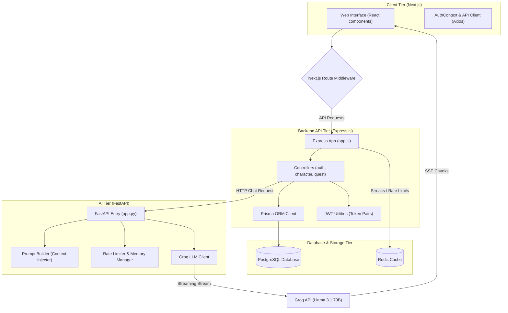

# 🏛️ DEVKIT — System & Design Architecture

This document describes the high-level system topology, data flow pipelines, and service boundaries of **DEVKIT**.

---

## 🗺️ System Topology Diagram

The diagram below represents the system components and their relationships:

---

## ⚡ Key Data Flow Pipelines

### 1. User Authentication & Authorization Flow
1.  **Request**: User types credentials on `/login` and hits submit.
2.  **Next.js Client**: `AuthContext` calls `authApi.login()`.
3.  **Express Backend**:
    *   `rateLimit.middleware` checks Redis/memory counters to prevent brute-force attacks.
    *   `auth.controller` validates email format via Zod schemas.
    *   Bcrypt compares the submitted password against the hash in the **PostgreSQL** database.
    *   If correct, `jwt.js` signs a short-lived **Access Token** (stored in cookies/localStorage) and a long-lived **Refresh Token** (stored in cookies).
4.  **Next.js Middleware**: Automatically inspects cookie credentials to unlock paths starting with `/dashboard` or `/quests`.

### 2. Conversational Companion Flow (AXIOM)
1.  **Trigger**: User sends a message in Mentor or Quest mode.
2.  **Express Backend**: Checks the user's active session, retrieves stats (Level, XP, Class) from PostgreSQL, and forwards the conversation to the AI Microservice.
3.  **FastAPI AI Server**:
    *   `rate_limiter.py` checks usage quotas (20 messages/day limit).
    *   `prompt_builder.py` reads user parameters and formats the `system_prompt.txt` instructions.
    *   `memory.py` injects previous conversation summary fragments to keep context windows compact.
4.  **Groq Client**: Passes parameters to the Groq API endpoint.
5.  **Streaming Delivery**: Text fragments stream from Groq back to FastAPI, then pass straight through Express directly to the React interface via **Server-Sent Events (SSE)**.

---

## 🛡️ Service Separation (App vs AI Repositories)

| Feature | App Service (`devkit-app`) | AI Service (`devkit-ai`) |
| :--- | :--- | :--- |
| **Primary Language** | TypeScript / JavaScript (Node.js) | Python |
| **Responsibilities** | User Auth, Progress Tracking, Quests Engine, Weapon Crafting, DB Management | Natural Language Mentoring, Game Quest Narrative, Code Explanation |
| **Storage Connects** | Direct connection to PostgreSQL and Redis | Stateless (fetches user profile data on-demand) |
| **LLM Inference** | None | Interacts directly with Groq API / Ollama engines |
